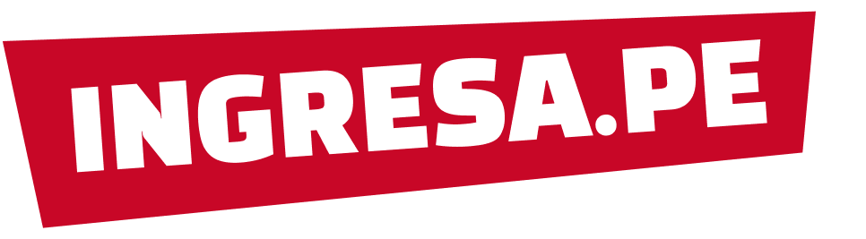
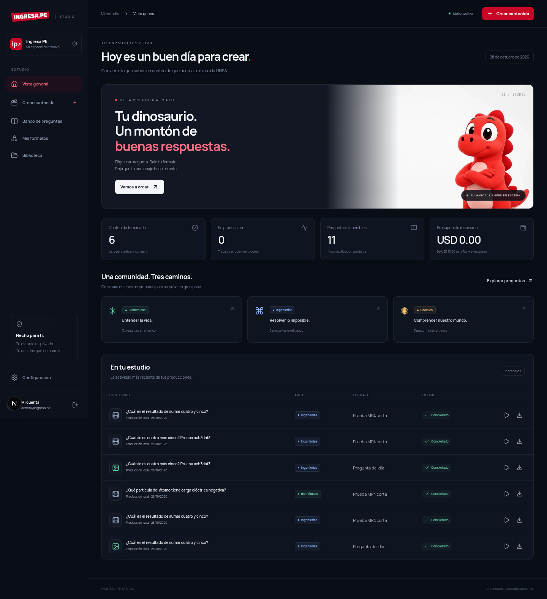
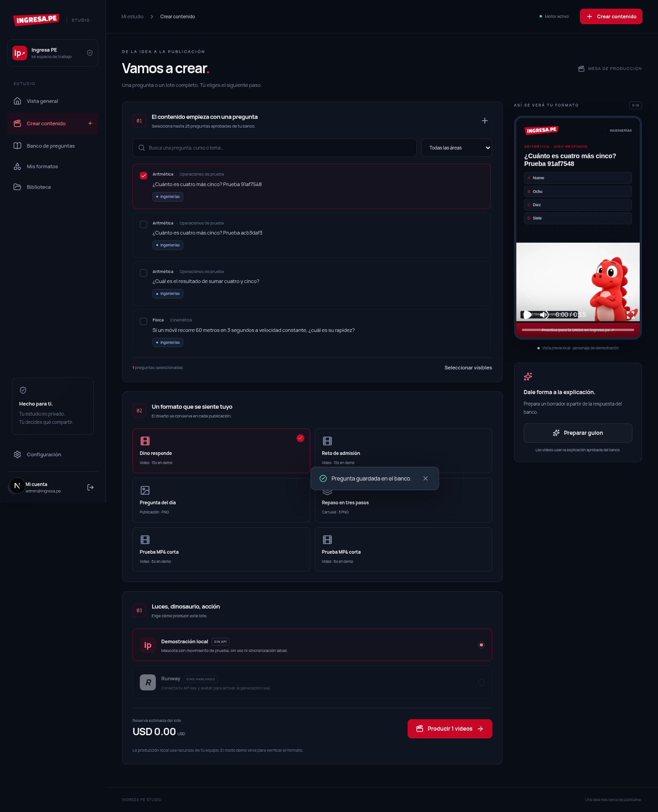

<div align="center">
  
  <h1>Ingresa PE Studio</h1>
  <p><strong>Tu dinosaurio. Tus formatos. Tu estudio de contenido.</strong></p>
  <p>Panel privado para convertir un banco de preguntas de la UNSA en videos, imágenes y carruseles, una pregunta o un lote a la vez.</p>
  <p>
    
    
    
    
  </p>
</div>



## Qué puedes hacer

- **Banco de preguntas:** organizar por Biomédicas, Ingenierías y Sociales, curso, tema y dificultad; guardar alternativas y explicación; aprobar antes de producir.
- **Formatos reutilizables:** Dino responde, reto con cuenta regresiva, pregunta del día y carrusel. Crear variantes de color y duración de demostración.
- **Producción por lotes:** hasta 25 preguntas por lote, cola persistente y concurrencia configurable.
- **Dinosaurio animado con Runway:** generar actuación y voz para cada respuesta usando un avatar propio; conservar pregunta, marca y diseño con Remotion.
- **Demostración local:** producir MP4 con movimiento sencillo de la mascota, sin voz ni sincronización labial, rotulado como demostración. Permite probar todo el circuito sin pagar una API.
- **Imágenes y carruseles:** PNG de 1080 × 1350; tres archivos por carrusel, compuestos localmente.
- **Biblioteca privada:** reproducir, subir imágenes y descargar medios mediante sesión.
- **Guion asistido:** preparar un borrador desde una explicación aprobada, con Gemini opcional.
- **Control:** estados de producción, cancelación, recuperación, protección ante duplicados y presupuesto estimado mensual para Runway.

El catálogo inicial incluye **nueve preguntas originales de muestra**, tres por área. No son preguntas oficiales ni predicciones de un examen.

## Empezar en tu equipo

Necesitas **Node.js 24 LTS**, npm, Docker con Compose y FFmpeg disponible en el PATH. La primera producción de video descarga Chrome Headless Shell para Remotion si todavía no está instalado.

```bash
git clone https://github.com/Choflis/IngresaPE_Marketing.git
cd IngresaPE_Marketing
npm ci
npm run setup
docker compose up -d db
npm run db:migrate
npm run db:seed
npm run dev
```

En otra terminal, dentro del mismo directorio:

```bash
npm run worker
```

Abre **http://localhost:3000**. Usa `localhost` también en el navegador para que coincida con `APP_URL` y la protección de origen.

**Cómo ingresar:** `npm run setup` genera una contraseña aleatoria y la guarda en `.env`, con permisos privados. El correo está en `ADMIN_EMAIL` y la contraseña en `ADMIN_PASSWORD`. No hay contraseña pública predeterminada. El archivo está excluido de Git. El setup conserva una configuración existente.

Si necesitas cambiar la contraseña: modifica `ADMIN_PASSWORD` en `.env` y ejecuta `npm run account:reset`. Las sesiones anteriores se revocan.

### Primera producción sin API

1. Entra a **Crear contenido**.
2. Filtra por área y selecciona una o varias preguntas aprobadas.
3. Elige **Dino responde** y **Demostración local**, o **Pregunta del día** para PNG.
4. Pulsa **Producir**. Sigue el estado desde Vista general.
5. Revisa y descarga desde **Biblioteca**.



## Ejecutar todo con Docker

Esta opción instala también FFmpeg y Chromium dentro de la imagen. Requiere más tiempo en el primer build.

```bash
npm ci
npm run setup
docker compose --profile app up --build -d
```

Abre **http://localhost:3000** e ingresa con las credenciales de tu `.env`. La web aplica migraciones y semilla al arrancar. Web y worker comparten un volumen de medios; PostgreSQL usa otro volumen. Los puertos publicados se limitan a la interfaz local.

```bash
docker compose logs -f web worker
docker compose --profile app stop
```

No ejecutes simultáneamente la web local y la web Docker sobre el puerto 3000. Evita duplicar workers sin intención: la concurrencia se suma entre procesos.

## Conectar y probar Runway

Necesitas una API key del **portal de desarrolladores de Runway con saldo**. Los créditos de la app web y los de API son independientes. Consulta las [condiciones y precios del proveedor](https://docs.dev.runwayml.com/guides/pricing/).

1. Guarda la clave en `.env`:

```dotenv
RUNWAYML_API_SECRET=tu_clave_privada
```

2. Comprueba autenticación y conexión; esta operación no genera videos:

```bash
npm run runway:check
```

3. Registra tu dinosaurio como avatar. Por defecto utiliza la imagen de marca incluida; puedes indicar otra imagen local:

```bash
npm run runway:avatar
# O: npm run runway:avatar -- /ruta/imagen-del-dinosaurio.png
```

El comando muestra el ID. Espera a que el avatar esté `READY` en el portal y guarda el valor:

```dotenv
RUNWAY_AVATAR_ID=uuid_del_avatar
RUNWAY_MONTHLY_BUDGET_CENTS=1000
```

4. Reinicia la web y el worker. **Runway** aparecerá disponible en el creador.
5. Para una prueba pagada corta, invocada explícitamente:

```bash
npm run runway:smoke
```

Este comando envía **una sola generación corta**, guarda el task ID y descarga el video a `storage/provider-tests/` si termina. No repitas el comando para consultar una solicitud anterior: cada ejecución genera un video nuevo. Conserva el comprobante JSON para consultar ese ID en el portal.

El presupuesto mensual protege **lotes creados en el panel**; las herramientas CLI y consumos externos de tu cuenta no pasan por esa reserva. Las reservas son conservadoras y no equivalen al saldo ni a una factura. Los trabajos enviados, incluso fallidos o cancelados después del envío, conservan su reserva porque pueden tener costo.

**Estado de la verificación real:** consultar [docs/verification.md](docs/verification.md). Sin credenciales con saldo no se puede afirmar que el dinosaurio haya sido generado por Runway. La demostración local siempre se identifica como tal.

### Recuperar un envío incierto

Si la conexión cae al crear una generación y no llega el task ID, el panel muestra **Revisar Runway**. Comprueba el portal y utiliza **Vincular tarea** con el ID original. El sistema continúa consultando esa generación y evita reenviarla automáticamente. Si Runway falló definitivamente, crea un lote nuevo solo cuando quieras una generación nueva.

## Configuración

| Variable                                  | Uso                                                                         |
| ----------------------------------------- | --------------------------------------------------------------------------- |
| `APP_URL`                                 | Origen del panel, por defecto `http://localhost:3000`.                      |
| `DATABASE_URL`                            | PostgreSQL de la aplicación. El puerto local de Compose es `5434`.          |
| `POSTGRES_PASSWORD`                       | Contraseña del contenedor PostgreSQL, generada por setup.                   |
| `ADMIN_EMAIL`, `ADMIN_PASSWORD`           | Cuenta inicial. Para cambios posteriores usa `account:reset`.               |
| `AUTH_COOKIE_SECURE`                      | `false` para HTTP local; `true` con HTTPS.                                  |
| `STORAGE_DIR`                             | Directorio persistente de medios.                                           |
| `WORKER_CONCURRENCY`                      | Trabajos concurrentes por proceso, de 1 a 8; por defecto 2.                 |
| `RENDER_CONCURRENCY`                      | Frames concurrentes por render de Remotion; por defecto 1.                  |
| `RUNWAYML_API_SECRET`, `RUNWAY_AVATAR_ID` | Credenciales y avatar para generación real.                                 |
| `RUNWAY_MONTHLY_BUDGET_CENTS`             | Reserva mensual máxima del panel en centavos de USD.                        |
| `GEMINI_API_KEY`, `GEMINI_MODEL`          | Borrador de guion opcional. La generación conserva la explicación aprobada. |

Para dos renders simultáneos, empieza con **4 CPU y 8 GB RAM** como orientación y mide el consumo de tu contenido. Incrementa concurrencia de forma gradual. La imagen Docker usa `shm_size: 1gb` en el worker.

Para acceso remoto privado, usa un túnel o VPN de tu elección. Si expones el panel en un servidor, configura HTTPS, `APP_URL` real y `AUTH_COOKIE_SECURE=true`; conserva la base y los volúmenes fuera de acceso público.

## Tecnología y modelo de datos

```text
Navegador → Next.js + sesión → PostgreSQL normalizado
                                  ↓ trabajos persistentes
                              pg-boss → worker
                                         ├─ Runway → personaje + voz
                                         ├─ Remotion → MP4
                                         └─ Sharp → PNG / carrusel
                                              ↓
                                    almacenamiento privado
```

- [Arquitectura, recuperación y fuentes técnicas](docs/architecture.md).
- [Modelo relacional, migraciones y respaldos](docs/database.md).
- [Contrato visual](DESIGN.md) y [uso de Open Design](docs/design/open-design.md).
- [Diseño funcional](docs/superpowers/specs/2026-10-28-studio-design.md) y [plan de implementación](docs/superpowers/plans/2026-10-28-studio.md).

La base separa preguntas, versiones, alternativas, áreas, cursos, temas y fuentes. Una relación muchos a muchos permite que una pregunta sirva para varias áreas. Cada producción referencia versiones concretas de pregunta y formato. Las solicitudes de proveedor y archivos son entidades separadas.

## Verificación y desarrollo

```bash
npm run typecheck
npm test
npm run test:db
npm run build

# Con PostgreSQL, web y worker ejecutándose:
npx playwright install --no-shell chromium
npm run test:e2e
```

`test:db` crea y usa exclusivamente `ingresape_studio_test`, nunca vacía la base principal. El E2E utiliza la instalación local, añade contenido de prueba y produce PNG y dos MP4 de demostración reales. Requiere la contraseña actual en `.env`.

`npm run format` aplica formato. El lockfile fija versiones. [Resultados y límites de verificación](docs/verification.md).

## Alcance de esta versión

Herramienta para un propietario. No publica automáticamente en redes. Los formatos son variantes de las composiciones incluidas; no hay editor libre de escenas. El avatar real y la voz requieren validar calidad con la imagen y cuenta de Runway. Los formatos cortos admiten hasta 240 caracteres de pregunta, 400 de explicación y 650 entre pregunta y alternativas, para conservar legibilidad. El listado carga hasta 1.000 preguntas y los 300 trabajos/archivos más recientes; la base y la cola conservan los demás.

El MP4 de demostración anima la imagen de marca, **no simula una actuación real ni una voz de Runway**. Las imágenes con plantillas evitan una API visual pagada, pero consumen servidor, almacenamiento y, si se habilita, modelos externos.

## Créditos

Diseño implementado siguiendo [Open Design](https://github.com/nexu-io/open-design), sus workflows `frontend-design` y `dashboard`, y su referencia `linear-app`, adaptados a Ingresa PE. Logo, mascota y paleta provienen de la marca. Manrope se distribuye con su [licencia OFL](public/fonts/OFL.txt).

Remotion tiene [condiciones de licencia propias](https://www.remotion.dev/docs/license/pricing), que dependen de la organización que lo utiliza. Este repositorio es una herramienta privada de Ingresa PE; no concede derechos sobre sus recursos de marca.
