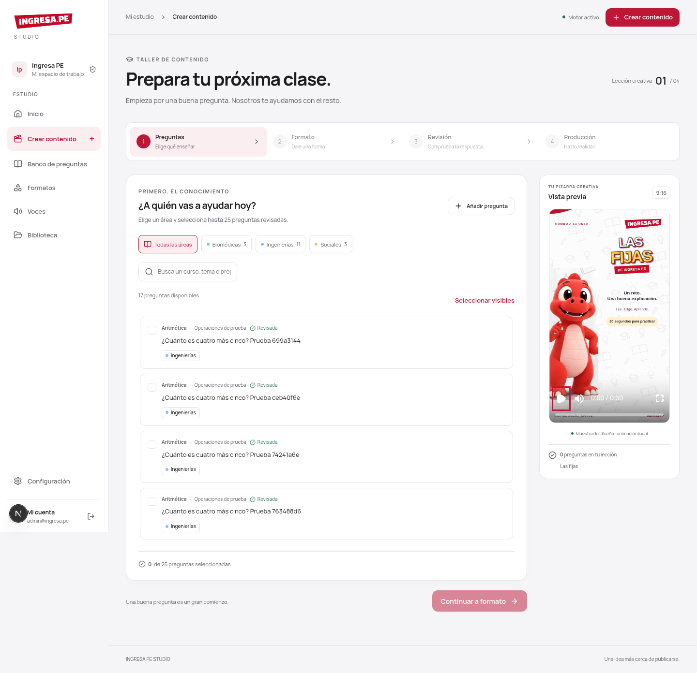
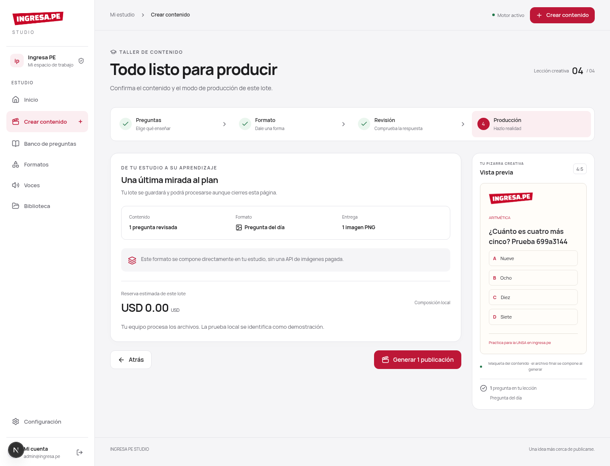

<div align="center">
  
  <h1>Ingresa PE Studio</h1>
  <p><strong>Tu dinosaurio. Tus formatos. Tu estudio de contenido.</strong></p>
  <p>Panel privado para convertir un banco de preguntas de la UNSA en videos, imágenes y carruseles, una pregunta o un lote a la vez.</p>
  <p>
    
    
    
    
  </p>
</div>


## Qué puedes hacer

- **Catálogo de formatos:** el inicio reúne videos, imágenes y carruseles. Puedes abrir cada formato y entrar al creador con él seleccionado. Las copias idénticas se agrupan visualmente, conservando sus versiones y trabajos.
- **Las fijas:** formato propio de 30 segundos basado en el ejemplo de la marca; presentación, lectura con cuenta regresiva, clave revisada y explicación, y cierre. El texto y las alternativas se componen con código, sin pedir a la IA que dibuje respuestas.
- **Voz pendiente:** escuchar y descargar el audio original de referencia. Por ahora las producciones no incluyen narración.
- **Banco de preguntas:** organizar por Biomédicas, Ingenierías y Sociales, curso, tema y dificultad; guardar alternativas y explicación; aprobar antes de producir.
- **Formatos reutilizables:** Dino responde, reto con cuenta regresiva, pregunta del día y carrusel. Crear variantes de color y duración de demostración.
- **Producción por lotes:** hasta 25 preguntas por lote, cola persistente y concurrencia configurable.
- **Dinosaurio animado con fal.ai:** generar la animación con LongCat Video Distilled 480p, desde imagen o texto; conservar pregunta, marca y diseño con Remotion.
- **Demostración local:** producir MP4 con movimiento sencillo de la mascota, sin voz ni sincronización labial, rotulado como demostración. Permite probar todo el circuito sin pagar una API.
- **Imágenes y carruseles:** PNG de 1080 × 1350; tres archivos por carrusel, compuestos localmente.
- **Biblioteca privada:** reproducir, subir imágenes y descargar medios mediante sesión.
- **Guion asistido:** preparar un borrador desde una explicación aprobada, con Gemini opcional.
- **Control:** estados de producción, cancelación, recuperación, protección ante duplicados y presupuesto estimado mensual para fal.ai.

El catálogo inicial incluye **nueve preguntas originales de muestra**, tres por área. No son preguntas oficiales ni predicciones de un examen.

## Empezar en tu equipo

Necesitas **Node.js 24 LTS**, npm, Docker con Compose y FFmpeg disponible en el PATH. La primera producción de video descarga Chrome Headless Shell para Remotion si todavía no está instalado.

```bash
git clone https://github.com/Choflis/IngresaPE_Marketing.git
cd IngresaPE_Marketing
npm ci
npm run setup
docker compose up -d db
npm run db:migrate
npm run db:seed
npm run dev
```

En otra terminal, dentro del mismo directorio:

```bash
npm run worker
```

Abre **http://localhost:3000**. Usa `localhost` también en el navegador para que coincida con `APP_URL` y la protección de origen.

**Cómo ingresar:** `npm run setup` genera una contraseña aleatoria y la guarda en `.env`, con permisos privados. El correo está en `ADMIN_EMAIL` y la contraseña en `ADMIN_PASSWORD`. No hay contraseña pública predeterminada. El archivo está excluido de Git. El setup conserva una configuración existente.

Si necesitas cambiar la contraseña: modifica `ADMIN_PASSWORD` en `.env` y ejecuta `npm run account:reset`. Las sesiones anteriores se revocan.

### Primera producción sin API

1. Entra a **Crear contenido** y selecciona preguntas aprobadas por área.
2. Continúa a **Formato** y elige cómo presentar la lección.
3. En **Revisión**, comprueba la respuesta correcta y la explicación.
4. En **Producción**, selecciona **Video local** para crear un MP4 sin API, o genera el PNG/carrusel. Verás el resumen antes de enviar.
5. Sigue el lote en Vista general y descarga desde **Biblioteca**. Puedes retroceder o ir a Configuración sin perder la selección mientras mantengas abierta la página.

Para revisar el formato de referencia con un MP4 real de 30 segundos, sin generación ni costo de API:

```bash
npm run preview:las-fijas
```

El comando guarda **Las fijas · 30 s · diseño sin voz.mp4** en Biblioteca y verifica su duración con FFprobe. Repetirlo actualiza la misma muestra. Es una vista del diseño con la imagen de referencia, no una generación de fal.ai.

En **Las fijas**, la pregunta aparece de 2 a 10 segundos; la clave y la explicación, de 10 a 27, y el cierre ocupa los últimos 3 segundos. La legibilidad se valida antes de producir, incluyendo la altura estimada de las alternativas. La IA solo anima al personaje; Remotion dibuja los textos y marca la respuesta del banco aprobado.

### Voz de referencia

La sección **Voces** conserva el audio del ejemplo para comparar timbre y ritmo cuando se integre una voz. LongCat no incluye narración ni sincronización labial en este flujo. No se ha elegido un proveedor de voz.

El video original en `ejemplo_Video/` se mantiene local y está excluido de Git. Si existe, puedes reproducirlo desde el detalle de Las fijas. En otra instalación sin ese archivo, la plantilla funciona normalmente y no muestra ese control. La imagen del personaje y el audio de referencia sí acompañan al proyecto.





## Ejecutar todo con Docker

Esta opción instala también FFmpeg y Chromium dentro de la imagen. Requiere más tiempo en el primer build.

```bash
npm ci
npm run setup
docker compose --profile app up --build -d
```

Abre **http://localhost:3000** e ingresa con las credenciales de tu `.env`. La web aplica migraciones y semilla al arrancar. Web y worker comparten un volumen de medios; PostgreSQL usa otro volumen. Los puertos publicados se limitan a la interfaz local.

```bash
docker compose logs -f web worker
docker compose --profile app stop
```

No ejecutes simultáneamente la web local y la web Docker sobre el puerto 3000. Evita duplicar workers sin intención: la concurrencia se suma entre procesos.

## Conectar fal.ai

1. Abre **Configuración → Anima con fal.ai**.
2. Copia una API key de tu [cuenta de fal.ai](https://fal.ai/dashboard), pégala en el campo privado y elige el modelo.
3. **Desde imagen** usa el dinosaurio de referencia y es el predeterminado. **Desde texto** usa una descripción y puede cambiar su apariencia.
4. Pulsa **Guardar configuración**. Guardar no genera contenido, no comprueba el saldo y no confirma permisos del proveedor. La autenticación se valida al generar.
5. En el creador, selecciona **fal.ai · Anima tu dinosaurio**, revisa el costo y genera el lote.

Modelos admitidos: [LongCat desde imagen](https://fal.ai/models/fal-ai/longcat-video/distilled/image-to-video/480p/api) y [LongCat desde texto](https://fal.ai/models/fal-ai/longcat-video/distilled/text-to-video/480p/api). Ambos usan 480p a 15 fps; los textos se componen localmente y el MP4 final es 720 × 1280 a 30 fps. Ampliar la salida no recupera detalle del clip original.

La tarifa de referencia es **US$0.005 por segundo generado**, calculando segundos como cuadros / 15. Para 30 segundos se solicitan 450 cuadros: **US$0.15 por video**, hasta **66 videos con US$10**, sin impuestos ni regeneraciones. No es una suscripción ilimitada. Revisa la tarifa vigente antes de recargar.

La configuración se guarda en `storage/config/fal.json` con permisos 0600, compartida por web y worker y excluida de Git. Como alternativa usa `FAL_KEY` y `FAL_MODEL` en `.env`. El archivo guardado desde el panel tiene prioridad. El modelo, prompt, duración e imagen quedan congelados en cada trabajo; cambiar la configuración afecta solo a los nuevos.

`FAL_MONTHLY_BUDGET_CENTS` limita las reservas mensuales del panel por propietario. No consulta el saldo real ni incluye consumos realizados directamente en fal.ai. Los trabajos enviados, incluso fallidos o cancelados, conservan su reserva porque pueden tener costo. Cancelar un trabajo no garantiza cancelar una inferencia ya iniciada ni un reembolso.

### Recuperar un envío incierto

Si se pierde la respuesta al crear una generación, el trabajo pasa a **Requiere revisión**. Comprueba el historial de fal.ai y utiliza **Vincular tarea** con su request ID original. El worker consulta y descarga ese resultado; no repite el POST pagado. Un fallo definitivo requiere un lote nuevo si deseas otra generación.

La integración anterior fue retirada. Sus trabajos y archivos históricos se conservan, pero no se ejecutan ni se envían a fal.ai. Crea un lote nuevo para producirlos con el nuevo proveedor.

## Configuración

| Variable                         | Uso                                                                         |
| -------------------------------- | --------------------------------------------------------------------------- |
| `APP_URL`                        | Origen del panel, por defecto `http://localhost:3000`.                      |
| `DATABASE_URL`                   | PostgreSQL de la aplicación. El puerto local de Compose es `5434`.          |
| `POSTGRES_PASSWORD`              | Contraseña del contenedor PostgreSQL, generada por setup.                   |
| `ADMIN_EMAIL`, `ADMIN_PASSWORD`  | Cuenta inicial. Para cambios posteriores usa `account:reset`.               |
| `AUTH_COOKIE_SECURE`             | `false` para HTTP local; `true` con HTTPS.                                  |
| `STORAGE_DIR`                    | Directorio persistente de medios.                                           |
| `WORKER_CONCURRENCY`             | Trabajos concurrentes por proceso, de 1 a 8; por defecto 2.                 |
| `RENDER_CONCURRENCY`             | Frames concurrentes por render de Remotion; por defecto 1.                  |
| `FAL_KEY`, `FAL_MODEL`           | Clave privada y modelo LongCat 480p.                                        |
| `FAL_MONTHLY_BUDGET_CENTS`       | Reserva mensual máxima del panel en centavos de USD.                        |
| `GEMINI_API_KEY`, `GEMINI_MODEL` | Borrador de guion opcional. La generación conserva la explicación aprobada. |

Para dos renders simultáneos, empieza con **4 CPU y 8 GB RAM** como orientación y mide el consumo de tu contenido. Incrementa concurrencia de forma gradual. La imagen Docker usa `shm_size: 1gb` en el worker.

Para acceso remoto privado, usa un túnel o VPN de tu elección. Si expones el panel en un servidor, configura HTTPS, `APP_URL` real y `AUTH_COOKIE_SECURE=true`; conserva la base y los volúmenes fuera de acceso público.

## Tecnología y modelo de datos

```text
Navegador → Next.js + sesión → PostgreSQL normalizado
                                  ↓ trabajos persistentes
                              pg-boss → worker
                                         ├─ fal.ai → animación sin voz
                                         ├─ Remotion → MP4
                                         └─ Sharp → PNG / carrusel
                                              ↓
                                    almacenamiento privado
```

- [Arquitectura, recuperación y fuentes técnicas](docs/architecture.md).
- [Modelo relacional, migraciones y respaldos](docs/database.md).
- [Contrato visual](DESIGN.md) y [uso de Open Design](docs/design/open-design.md).
- [Diseño funcional](docs/superpowers/specs/2026-10-28-studio-design.md) y [plan de implementación](docs/superpowers/plans/2026-10-28-studio.md).

La base separa preguntas, versiones, alternativas, áreas, cursos, temas y fuentes. Una relación muchos a muchos permite que una pregunta sirva para varias áreas. Cada producción referencia versiones concretas de pregunta y formato. Las solicitudes de proveedor y archivos son entidades separadas.

## Verificación y desarrollo

```bash
npm run typecheck
npm test
npm run test:db
npm run build

# Con PostgreSQL, web y worker ejecutándose:
npx playwright install --no-shell chromium
npm run test:e2e
```

`test:db` crea y usa exclusivamente `ingresape_studio_test`, nunca vacía la base principal. El E2E utiliza la instalación local, añade contenido de prueba y produce PNG y dos MP4 de demostración reales. Requiere la contraseña actual en `.env`.

`npm run format` aplica formato. El lockfile fija versiones. [Resultados y límites de verificación](docs/verification.md).

## Alcance de esta versión

Herramienta para un propietario. No publica automáticamente en redes. Los formatos son variantes de las composiciones incluidas; no hay editor libre de escenas. La calidad de animación de fal.ai requiere comprobarse con una generación real; la voz queda pendiente. Los formatos cortos admiten hasta 240 caracteres de pregunta, 400 de explicación y 650 entre pregunta y alternativas, para conservar legibilidad. El listado carga hasta 1.000 preguntas y los 300 trabajos/archivos más recientes; la base y la cola conservan los demás.

El MP4 de demostración anima la imagen de marca, **no utiliza fal.ai ni incluye voz**. Las imágenes con plantillas evitan una API visual pagada, pero consumen servidor, almacenamiento y, si se habilita, modelos externos.

## Créditos

Refactor del catálogo y del estudio guiado por [Apple Design Skill](https://github.com/dickwu/apple-design-skill): jerarquía, tipografía legible, controles claros, foco visible, adaptación a móvil, apariencia oscura y movimiento reducido; se aplican sus principios web, conservando la identidad educativa de Ingresa PE.

Diseño implementado siguiendo [Open Design](https://github.com/nexu-io/open-design), sus skills `frontend-design` e `impeccable-design-polish`, adaptadas a una interfaz académica clara, adaptados a Ingresa PE. Logo, mascota y paleta provienen de la marca. Manrope se distribuye con su [licencia OFL](public/fonts/OFL.txt).

Remotion tiene [condiciones de licencia propias](https://www.remotion.dev/docs/license/pricing), que dependen de la organización que lo utiliza. Este repositorio es una herramienta privada de Ingresa PE; no concede derechos sobre sus recursos de marca.
