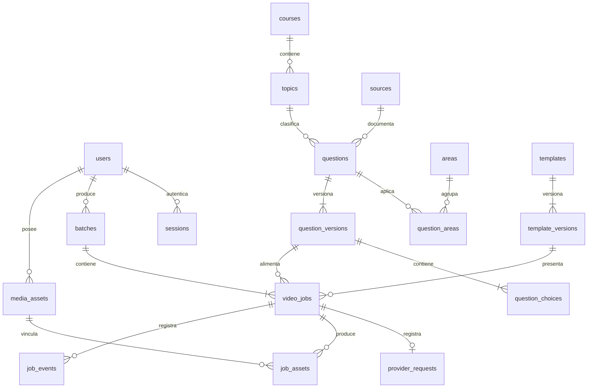

# Modelo relacional



Catálogo compartido para un único propietario. `video_jobs` conserva el nombre histórico por compatibilidad de API, pero representa videos, imágenes y carruseles. Las alternativas correctas se validan antes de entrar en una transacción. Las versiones utilizadas para producir no se sobrescriben. Aprobar una pregunta pendiente crea una versión nueva y copia sus alternativas.

## Migraciones

`npm run db:migrate` aplica una sola vez cada archivo de `db/migrations`, en orden y bajo lock transaccional. Los errores hacen rollback. No hay sincronización destructiva automática del esquema.

La migración `002_formats_and_voices.sql` añade composiciones y Las fijas. Sus tablas de voces se conservan como datos históricos, sin API activa. La migración `003_fal_provider.sql` incorpora `fal` y el snapshot técnico `generation_config`; bloquea los trabajos pendientes del proveedor retirado para evitar ejecutarlos accidentalmente. Conserva sus archivos, IDs y estados de solicitud.

## Respaldos

La base y los medios forman un conjunto. Guarda ambos; un dump SQL sin el volumen de medios no contiene los MP4/PNG.

```bash
docker compose exec -T db pg_dump -U studio -d ingresape_studio -Fc > studio.dump
# Instalación local: respaldar ./storage con la herramienta de backup que uses.
# Instalación Docker: respaldar también el volumen media_data.
```

Para restaurar, utiliza una base nueva y `pg_restore`; no sobrescribas una instalación en uso. El `.env` se conserva de forma privada y nunca se versiona.
